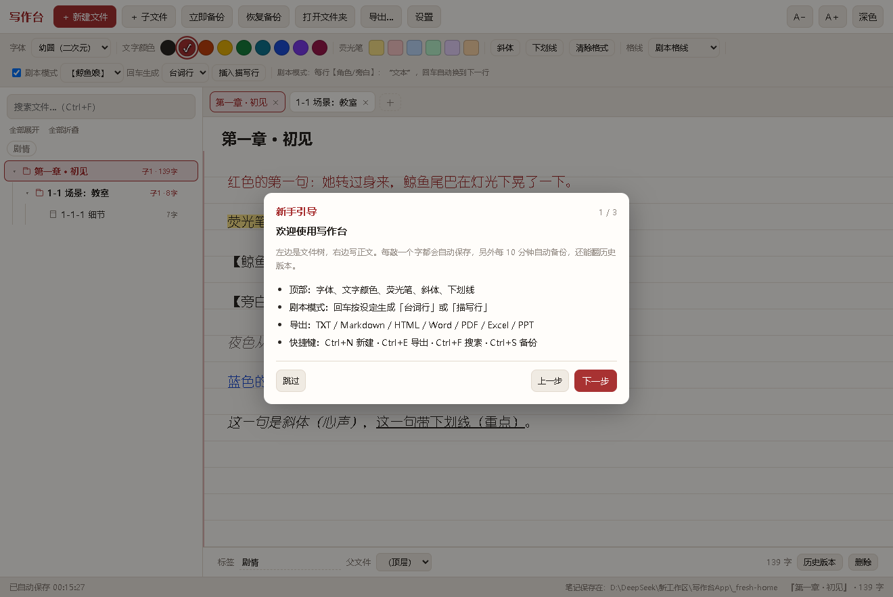

# 写作台 · X2.3.5

一个给写小说 / 写剧本用的桌面写作软件（Electron）。左边是多层文件树，右边直接写正文，**每敲一个字自动保存**，每 10 分钟自动备份，还能翻历史版本。

本软件是为了给同人/ galgame作者写剧本服务的，所以它的「剧本模式」是照着视觉小说的台本格式做的：`【角色】：“台词”`，回车按设定自动生成下一行。

- 版本：**X2.3.5**
- 平台：Windows 10 / 11（x64）
- 授权：CC BY-NC-SA 4.0（署名 · 非商业 · 相同方式共享），详见 [LICENSE](LICENSE)



## 下载安装

去 [Releases](../../releases) 下载 **写作台-X2.3.5-安装包.zip**，解压后双击 `写作台-安装包-2.3.5.exe`，一路下一步即可。

> 软件没有购买代码签名证书，第一次运行 Windows 可能提示「已保护你的电脑」→ 点「更多信息」→「仍要运行」。

## 功能

### 写作
- **自动保存**：每次输入即存盘，另有每 10 分钟自动备份（保留最近 50 份）与历史版本（最多 8 版）
- **多层文件**：父文件 / 子文件无限嵌套，缩进引导线 + 文件夹图标区分层级
- **剧本模式**：`【角色】：“台词”`，回车按「回车生成」自动插入**台词行**或**描写行**（描写行＝普通段落，写心境 / 风景 / 天气，显示为灰色斜体）
- **排版**：字体（幼圆 / 方正舒体 / 华文琥珀 / 楷体 / 隶书 …）、字号、格线（横线 / 方格 / 点阵 / 剧本格线）、深色模式
- **格式**：文字颜色、荧光笔、斜体、下划线；「清除格式」只清格式、保留文字颜色
- **壁纸**：选图片 / 截图 Ctrl+V / 拖入文件，底纹浓度可调
- **语言**：中文 / 日本語 / English

### 导出
TXT · Markdown · HTML · Word(.docx) · PDF · Excel(.xlsx) · PowerPoint(.pptx)，范围可选「当前文件 / 整棵树」。

- Word / HTML / PDF 保留颜色、荧光笔、斜体、下划线
- Excel 两张表：目录清单 + 台词表（场景 / 行号 / 类型 / 角色 / 台词或描写 / 字数），「类型」列方便配音和校对时筛
- PPT 每篇文件一页大纲

### 数据
稿子默认不在 C 盘（有 D 盘就放 `D:\写作台笔记`），随时可在「设置 → 更改保存位置」换盘并迁移。目录结构：

```
笔记数据.json   主数据
正文/           每篇一个 txt（人和 AI 都能直接读）
正文/_目录.md   多层目录大纲
备份/           自动备份
```

## 快捷键

| 快捷键 | 作用 |
|---|---|
| Ctrl+N | 新建文件 |
| Ctrl+S | 立即备份 |
| Ctrl+E | 导出 |
| Ctrl+F | 搜索 |
| Ctrl+I / Ctrl+U | 斜体 / 下划线 |
| Shift+Enter | 普通换行（不触发剧本模式） |

## 开发 / 自己打包

```bash
pnpm install          # 或 npm install
pnpm start            # 开发运行（electron .）
pnpm dist             # 打包 NSIS 安装包到 dist/
```

- Electron 45 / electron-builder 26
- 打包脚本见 `package.json` 的 `build` 字段，`build/afterPack.js` 会裁掉多余的语言包减小体积
- 自测：`electron . --selftest=out.png --selftest-log=log.json`（截图 + 功能自检，不写用户数据）

代码结构：

| 文件 | 作用 |
|---|---|
| `main.js` | 主进程：窗口、数据目录、IPC、导出、壁纸 |
| `preload.js` | contextBridge 暴露给渲染进程的 API |
| `index.html` | 界面 + 编辑器逻辑（约 100KB，含样式） |
| `exporters.js` | 七种格式导出（docx/xlsx/pptx 用自写的 ZIP 写入器，零依赖） |
| `i18n.js` | 中 / 日 / 英 界面文案 |
| `assets/pptx-template` | PPTX 模板 XML |

## 已知限制

- 只支持 Windows x64
- 未做代码签名，可能有杀软误报
- 富文本基于 `document.execCommand`，复杂粘贴（网页表格等）会被简化成纯文本

## 致谢

界面用到的中文字体来自系统自带字体（不随软件分发）。软件本身用 Electron + 自写导出器，没有引入富文本编辑器依赖。
